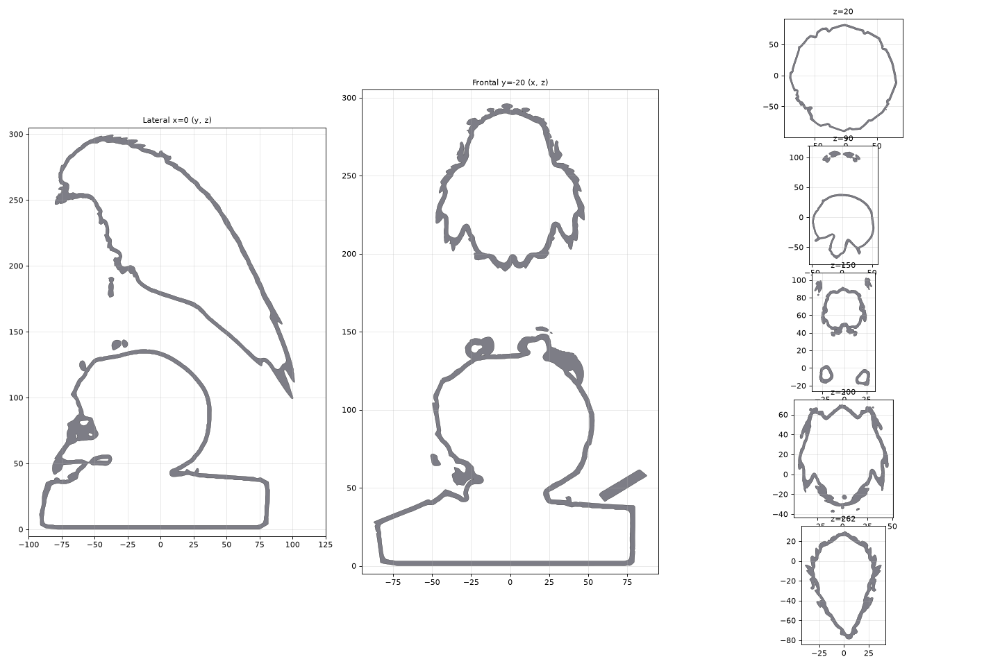
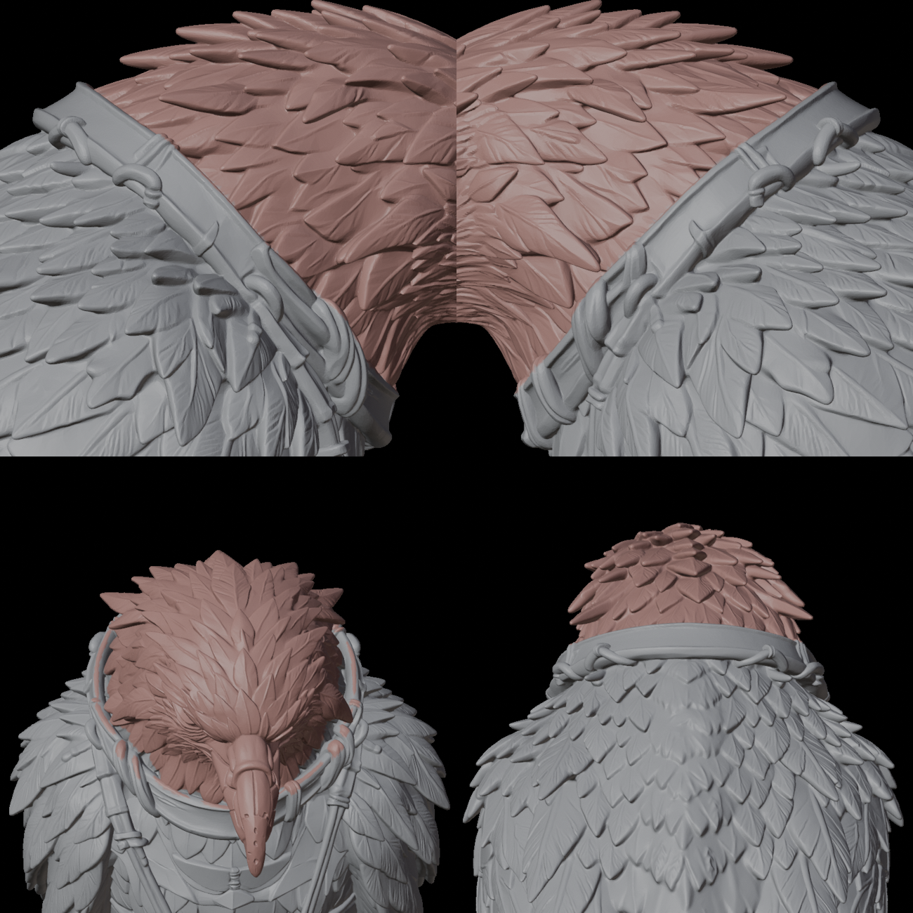
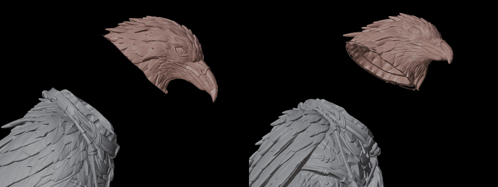
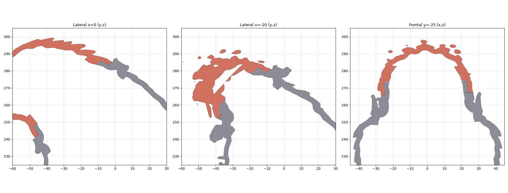
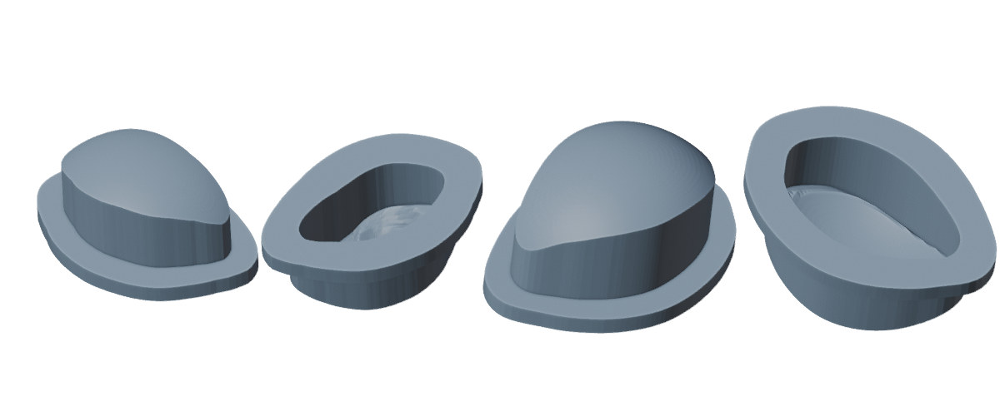
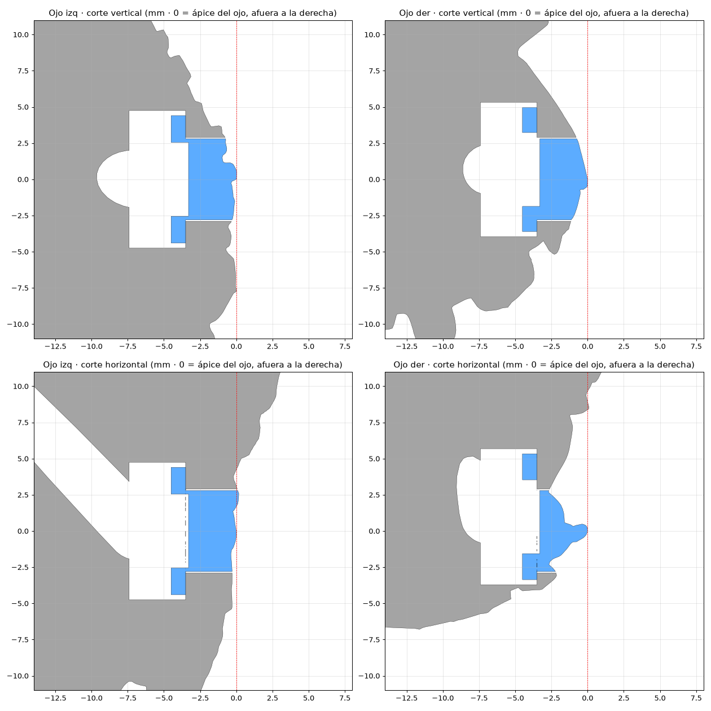
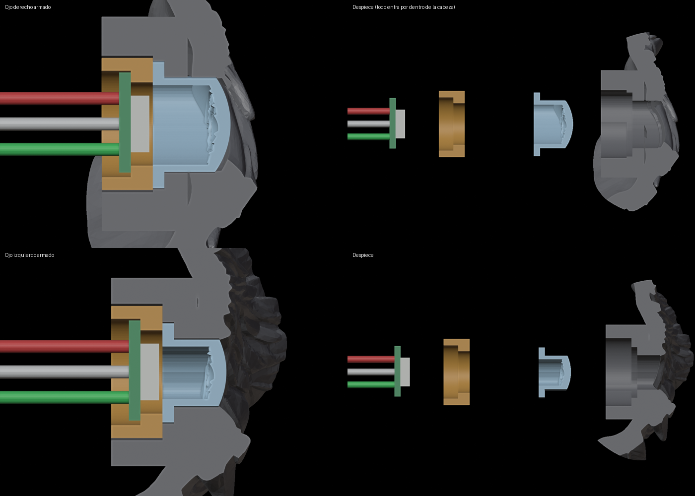
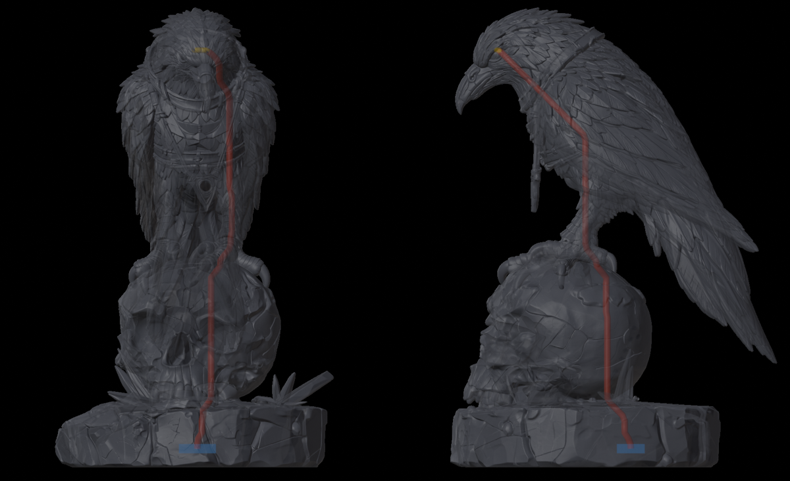

# Diseño interno del cuervo

> Análisis del modelo `forma preliminar.stl` (7/11/2026) y propuesta para imprimirlo
> en resina: hueco, cabeza desmontable, cables por dentro, electrónica y lastre en una
> tapa inferior. Scripts en [`../hardware/analisis/`](../hardware/analisis/).

## Lo que dice el modelo

| Dato | Valor |
|---|---|
| Tamaño total | 181 × 212 × 300 mm (ancho × fondo × alto) |
| Malla | 2,7 M caras, una sola pieza; 8 bordes abiertos y 82 aristas defectuosas (reparable) |
| Volumen macizo | **2.367 cm³** de resina |
| Volumen hueco, paredes de 3 mm | **504 cm³** → **79 % menos resina** |

### Alturas de cada parte

| Parte | Altura (z) | Sección |
|---|---|---|
| Roca (base) | 0 – 38 mm | hasta 159 mm de ancho útil |
| Calavera | 40 – 137 mm | hasta 98 mm de ancho |
| Patas (tarsos) | 140 – 170 mm | **dos patas en x ≈ ±21 mm** |
| Cuerpo | 170 – 285 mm | hasta 88 mm |
| Cabeza | sobre el collar, z ≈ 245 (garganta) a 287 (nuca) | ~50 mm de ancho |
| Cola | cuelga libre detrás de la calavera hasta z ≈ 70 | **no toca la roca** |

### Las patas: ¿caben los cables?

- Grosor mínimo de cada pata: **10 – 12 mm** de diámetro (más delgada hacia z ≈ 157).
- Mazo de 3 cables de 30 AWG con silicona: ~2,2 mm → **canal de Ø 3 mm**.
- Queda pared de **3,5 – 4,5 mm** a cada lado.
- Efecto en la resistencia de esa pata: el área baja ~8 % y la rigidez a flexión
  **menos del 1 %** (un agujero en el centro casi no trabaja). **Es viable.**
- El canal tiene que salir **modelado** desde la impresión (curvo: muslo → tarso →
  pie → calavera); no se puede taladrar después. Se enhebra con un alambre guía.
- La cola no sirve de ruta: cuelga libre y no llega a la roca.

### El collar: el corte de la cabeza

El collar es una correa **inclinada**: de la garganta (z ≈ 245) a la nuca (z ≈ 285).
Cortar siguiendo esa correa esconde la costura en un detalle que ya existe. Los dos
ojos (z ≈ 268, adelante) quedan del lado de la cabeza.

## Propuesta

### Piezas

1. **Cabeza** — hueca, se quita por el collar.
   - 3 pines cónicos asimétricos (Ø 4 × 4 mm, holgura 0,2 mm): solo entra en una posición.
   - 2 imanes de 6 × 2 mm para que no se caiga y se pueda abrir en mantenimiento.
   - Bolsillo para cada LED detrás del ojo (Ø 11 × 4 mm, a 3–5 mm de la superficie),
     canal de cada ojo hacia el cuello, y espacio para la silicona que aísla la luz.
2. **Cuerpo + patas + calavera + roca** — hueco con paredes de 3 mm.
   - Canal de Ø 3 mm por **una** pata, del cuerpo a la calavera.
   - Abierto por debajo: por ahí escurre la resina al lavar y entra la tapa.
3. **Tapa inferior** — donde va todo lo demás:
   - Bahía para la ESP32 con el **USB-C hacia atrás**, por una ranura en la pared de la roca.
   - **Cámara de lastre** sellada (yeso o cemento, unos 500 g) lo más abajo posible.
   - Ranuras de ventilación por debajo, separada del piso por patitas de 3–4 mm.
4. **Botón** — interruptor MX en la pared de la roca. El keycap es **el mismo pedazo
   de roca recortado** (se extrae de la malla), con 0,4 mm de holgura: no se ve que es un botón.

### Cómo se sujeta la tapa: comparación

| Opción | A favor | En contra |
|---|---|---|
| **Bayoneta ¼ de vuelta** ("piñón") | Sin herramientas, aguanta el lastre | El botón y el USB no pueden ir en la tapa (giraría) |
| **Clips a presión** | Rápido | La resina estándar es quebradiza: los clips se parten |
| **Imanes** | Muy fácil de abrir | Con 500 g de lastre, al levantar la pieza la tapa se puede caer |
| **2 tornillos ocultos** bajo patitas de goma | El más robusto y barato | Hace falta un destornillador |

### Paso 1 · Ahuecado (hecho, 7/11/2026)

`hardware/modelado/ahuecar.py`: paredes de **3 mm**, superficie exterior intacta.

| | |
|---|---|
| Resina maciza | 2.326 cm³ |
| Resina hueca | **551 cm³ (−76 %)** |
| Cavidad | una sola, conectada: cabeza ↔ cuerpo ↔ **patas** ↔ calavera ↔ roca |

- **Las dos patas quedan huecas de punta a punta**: conducto mínimo de 4,5 mm (z ≈ 160).
  Los cables (mazo de ~2,2 mm) pasan por ahí: no hace falta canal aparte.
- Pico, plumas sueltas y punta de la cola quedan macizos (no admiten hueco de 5 mm).
- Al estar todo conectado, la resina sin curar escurre por la abertura de la tapa inferior.

### ¿3 mm o 5 mm de pared?

| Pared | Resina | Peso aprox. (1,15 g/cm³) |
|---|---|---|
| **3 mm** | 551 cm³ | ~630 g |
| 4 mm | 701 cm³ | ~805 g |
| 5 mm | 849 cm³ | ~975 g |

**Decisión: 3 mm, con refuerzos locales.** Razones:
- Lo que se rompe en una escultura de resina no es el cascarón sino lo que sobresale:
  plumas sueltas, pico, cola y patas. Esas partes ya son macizas, así que pasar a 5 mm no las
  protege; solo agrega 300 cm³ (+54 % de resina) y peso.
- La carga real es mínima: cabeza + cuerpo sobre las patas son ~0,02 MPa de compresión.
- Refuerzos donde sí importa: **5 mm en la franja del corte de la cabeza** (12 mm a cada lado),
  y después en la roca donde asienta la tapa y van los tornillos.
- Para resistencia a golpes rinde más una resina tipo ABS/tough que más espesor.
- Pata sin cables: se puede meter una varilla de acero de 2 mm con epóxico por su conducto hueco.

### Paso 2 · Corte de la cabeza (hecho, 7/11/2026)

El corte **no es un plano**: sigue el canto real del collar, donde termina la correa y empieza
el plumaje (`borde_collar.py` mide ese canto alrededor de todo el cuello).

- **Cabeza**: 29,7 cm³. **Cuerpo**: 530,4 cm³. Una pieza cada uno.
- **Unión para pegar** (`cortar_cabeza.py`): el cuerpo lleva un **labio de 5 mm** de alto por
  dentro del cuello; la cabeza lleva su ranura. Holgura 0,15 mm para el pegamento. El labio sigue
  la forma irregular del cuello: la cabeza **solo entra en una posición**.
- Pared de 5 mm en la franja de la unión: el borde de la cabeza no queda frágil antes de pegar,
  y el pegamento tiene canto + las dos caras del labio.
- Los cables pasan por dentro del labio (cuello hueco).

### Ojos: primera versión (se rehace después del corte de la cabeza)

> La primera versión tenía el iris por fuera. Se cambia: **liso por fuera**, iris en relieve
> **por dentro** (más resina = más oscuro). Se rehace después de cortar la cabeza.

- Cada ojo es una pieza aparte (`hardware/stl/ojo_izq.stl`, `ojo_der.stl`), generada con
  `hardware/modelado/ojos.py` sobre la malla reparada.
- **Por fuera** conserva el labrado esculpido (iris y párpado) dentro de Ø 5,6 mm: en resina
  transparente, más material se ve más oscuro y menos material más claro.
- **Reborde** Ø 8,8 × 1 mm por dentro: se mete desde el interior de la cabeza y no puede salir.
- **Encastre del LED**: rebaje cuadrado de 5,1 × 5,1 × 1,2 mm atrás, donde entra el LED 5050
  (4,8 × 4,9 medido). El LED queda centrado y a **3,3 mm** de la superficie del ojo.
- **En la cabeza**: agujero ajustado (holgura 0,1 mm), escalón Ø 9,5 mm para el reborde y el PCB
  del LED (Ø 8,9 medido) y canal de cables Ø 4 mm hacia el centro de la cabeza.
- Ojo derecho: la pared es delgada debajo del ojo, así que el reborde va corrido 1,2 mm hacia
  adentro (automático). Pared mínima ahí ≈ 0,4 mm: revisar en la primera impresión.

### Pendiente de decidir

- ~~Impresora~~: **Elegoo Jupiter 2**, 302,4 × 162 × 300 mm. El cuervo (181 × 212 × 300) no cabe
  de pie en Y: hay que dividirlo o acostarlo.
- Cómo se ve el ojo encendido: ¿cabeza en resina transparente pintada menos los ojos?
- Sujeción de la tapa y ubicación del botón.

## Firmware: un solo botón

Si queda **un** botón, WLED solo repite el brillo al mantener en botones de índice
mayor que 0. Con el firmware propio se resuelve en `Cuervo_Estado`: toque =
encender/apagar, mantener = brillo, 5 s = red de configuración (sin reset de fábrica).

### Paso 3 · Ojos, porta-LED y cables (8/11/2026)

- **Inserto transparente** (`ojos6.py` + `iris.py`, estilo fibras v2): cúpula lisa por fuera, iris en relieve
  por dentro (fibras de 0,2 mm, collarete, pupila en cuenco). Entra **por dentro** de la cabeza hasta su asiento.
- **Porta-LED** (pieza aparte, resina opaca): tapón con la forma del reborde (solo entra en una posición) que aprieta
  el inserto. Lleva la **ventana Ø7,2** para el LED 5050, el **tope** donde asienta el PCB redondo Ø8,9 (LED a 0,3 mm del
  reborde) y la **cámara** de 1,5 mm detrás del PCB para las soldaduras.
- Los dos ojos casi se tocan por dentro (ejes convergentes): entre los fondos de los porta-LED quedan **10,5 mm**.

#### Cables (`rutas_cable.py`)

Cadena: ESP32 (GPIO 4) → ojo A (DIN) → DOUT → ojo B (DIN). 5V y GND en paralelo. Cable de silicona 30 AWG.

| Tramo | Ruta más corta por dentro | **Cortar** |
|---|---|---|
| Base (ESP32) → ojo A | 31 cm: roca → pata (x ≈ +22) → cuerpo → cuello → cabeza | **42 cm** (+15 % de holgura, +5 cm de servicio en la base, +2 cm para soldar) |
| Ojo A → ojo B | 1 cm entre porta-LED | **6 cm** (para soldar ambos LED afuera y meterlos por el cuello) |

En la base, el mazo termina en un conector JST de 3 pines: la ESP32 se puede cambiar sin tocar la cabeza (que va pegada).

