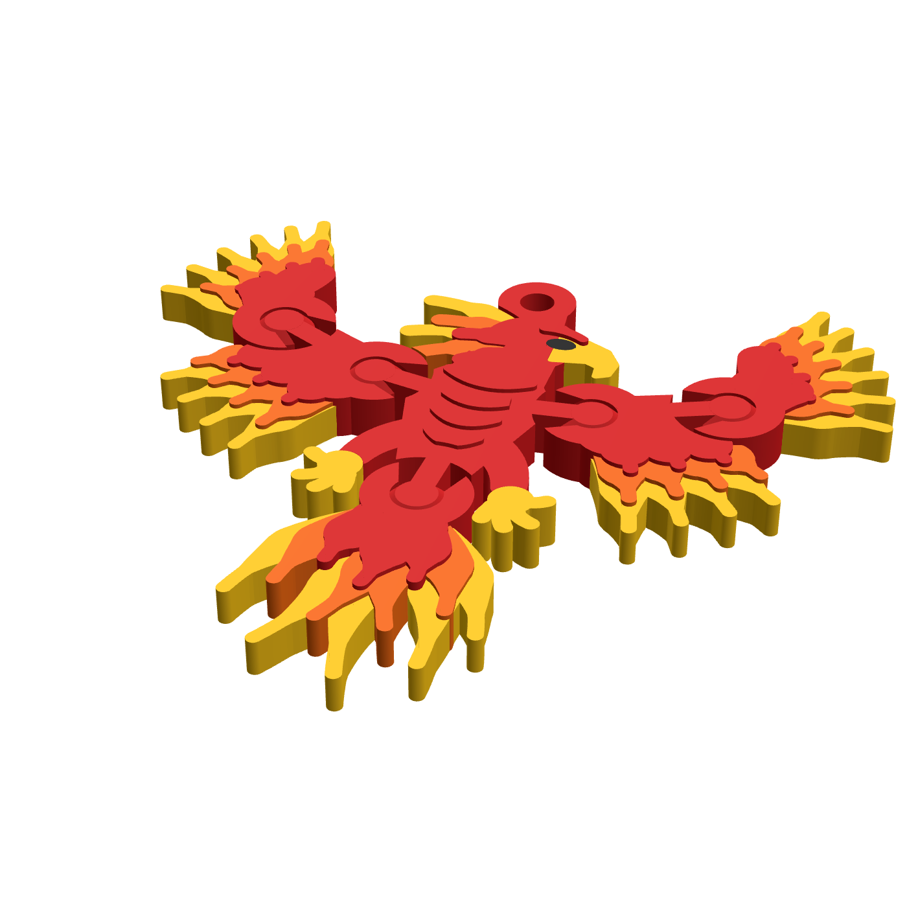

# Fénix flexi: llavero articulado para Bambu Lab A1 Combo




**Tamaño:** 69,8 × 64,1 × 4,4 mm (cabe en la palma; el diseño original medía unos 105 mm).
**Peso aproximado:** 7 g de PLA (rojo 4,2 g, amarillo 1,7 g, naranja 1,1 g y una pizca de negro).

## Qué se mueve y qué no
| Pieza | Movimiento |
|---|---|
| Cuerpo, cabeza, cresta, anilla, **patas y garras** | **Fijas**: una sola pieza rígida |
| Hombros (×2) | Bisagra: unos 26° hacia arriba y 22° hacia abajo |
| Codos (×2) | Bisagra: ±26° |
| Cola | Bisagra: unos ±12° |

En total son **6 piezas y 5 bisagras**. Se imprime todo de una vez, ya montado y sin soportes.

## Mejoras aplicadas respecto a la imagen original
1. **Las patas son fijas**: forman parte del cuerpo. Así hay menos piezas sueltas y el cuerpo queda más resistente.
2. **Las bisagras tienen tope**: el anillo en "C" solo deja girar unos ±20–26°, así que las alas no pueden darse la vuelta.
3. **La bisagra no necesita puentes ni soportes**: el pivote tiene biseles a 45° arriba y abajo. Eso retiene la pieza en vertical (no se sale por arriba ni por abajo) y además se imprime limpio.
4. **El pivote no se sale de lado**: el cuello que une el pivote a su pieza es más estrecho (2,2 mm) que el pivote (5,6 mm). Se ha comprobado por simulación: ninguna pieza se desplaza más de 0,9 mm antes de chocar.
5. **Las plumas son más robustas**: tienen 4–5 mm de ancho en la base, una punta mínima de 1,25 mm y entre 3,2 y 4 mm de espesor. Las puntas no son agujas.
6. **El color va por capas de altura** en lugar del degradado imposible de la imagen. El amarillo queda detrás y más bajo (3,2 mm), el naranja en medio (3,6 mm) y el rojo delante y más alto (4,0 mm). El pecho y la ceja llevan un relieve de 4,4 mm. El resultado da un efecto 3D de plumas superpuestas.
7. **La anilla está reforzada**: el agujero mide 3,2 mm, la pared 2 mm, y está unida con un bloque macizo a la cabeza, que es fija.
8. **El tamaño se ha reducido al mínimo práctico**: lo que limita es el diámetro de las bisagras (9,5 mm), que no se puede bajar sin perder resistencia.

## Archivos (`salida/`)
| Archivo | Uso |
|---|---|
| `fenix_completo_A1.3mf` | Un objeto con 4 partes y el filamento ya asignado a cada una. El color atraviesa todo el espesor y es el que mejor se ve. |
| `fenix_economico_A1.3mf` | Igual, pero la base es roja hasta 2 mm y el color solo va encima. Necesita aproximadamente la mitad de cambios de filamento y genera menos purga. Por los lados se ve una franja roja abajo. |
| `stl_completo/`, `stl_economico/` | Un STL por color, por si el 3MF no carga las asignaciones. |
| `vista_plana.png`, `render_*.png` | Vistas previas |

**Ranuras del AMS lite:** 1 = rojo · 2 = naranja · 3 = amarillo · 4 = negro (ojo).

### Si usas los STL
1. En Bambu Studio, arrastra **los 4 STL de una carpeta a la vez**.
2. Cuando pregunte *"¿Cargar como un único objeto con varias partes?"*, responde **Sí**.
3. En la lista de objetos, asigna a cada parte su filamento según el número del nombre del archivo.

## Ajustes de impresión recomendados (A1, boquilla 0,4)
- **Material:** PLA Basic o PLA Matte. El PLA Silk es más débil entre capas y conviene evitarlo en las bisagras.
- **Altura de capa:** 0,20 mm (perfil 0.20mm Standard). No uses capas más gruesas de 0,24 mm, porque las holguras están calculadas para 0,2.
- **Paredes:** 3. Capas superiores e inferiores: 4/3. Relleno: 20 % gyroid. Casi todo queda macizo de todas formas.
- **Soportes: NO. Borde (brim): NO.** El brim uniría las piezas móviles entre sí.
- **Compensación de pata de elefante:** 0,15 mm, que es el valor por defecto. Es importante para que las bisagras no se suelden en la primera capa.
- **Torre de purga:** activada. Para ahorrar material, activa *Flush into objects' infill*.
- **Placa:** PEI texturizada, limpia. Primera capa a velocidad normal del perfil.

### Después de imprimir
1. Retira la pieza de la placa ya fría.
2. Mueve **cada bisagra con suavidad**, primero un poco y luego todo su recorrido, hasta que gire libre. Es normal que al principio estén algo duras.
3. Pon una anilla de salto de 6–8 mm en el agujero de la cabeza y la anilla del llavero.

## Holguras usadas (editables en `fenix.py`)
| Parámetro | Valor | Si las bisagras salen soldadas | Si salen muy flojas |
|---|---|---|---|
| `G` (en el plano) | 0,45 mm | subir a 0,50 | bajar a 0,40 |
| `C` (pivote/anillo) | 0,45 mm | subir a 0,50 | bajar a 0,40 |

## Regenerar el modelo
```bash
pip install numpy shapely manifold3d trimesh matplotlib
python3 fenix.py            # escribe todo en salida/ y ejecuta las comprobaciones
python3 fenix.py --rapido   # solo la vista plana, para iterar el diseño
```
`ESCALA` (0,9) cambia el tamaño del dibujo, pero no las bisagras ni la anilla, que tienen medidas fijas en mm. Por debajo de 0,9 el cuerpo se queda demasiado estrecho entre las bisagras de los hombros.

El script comprueba en cada ejecución que cada pieza es un único sólido, mide la holgura real entre piezas, el rango de giro libre y la retención de cada bisagra.
