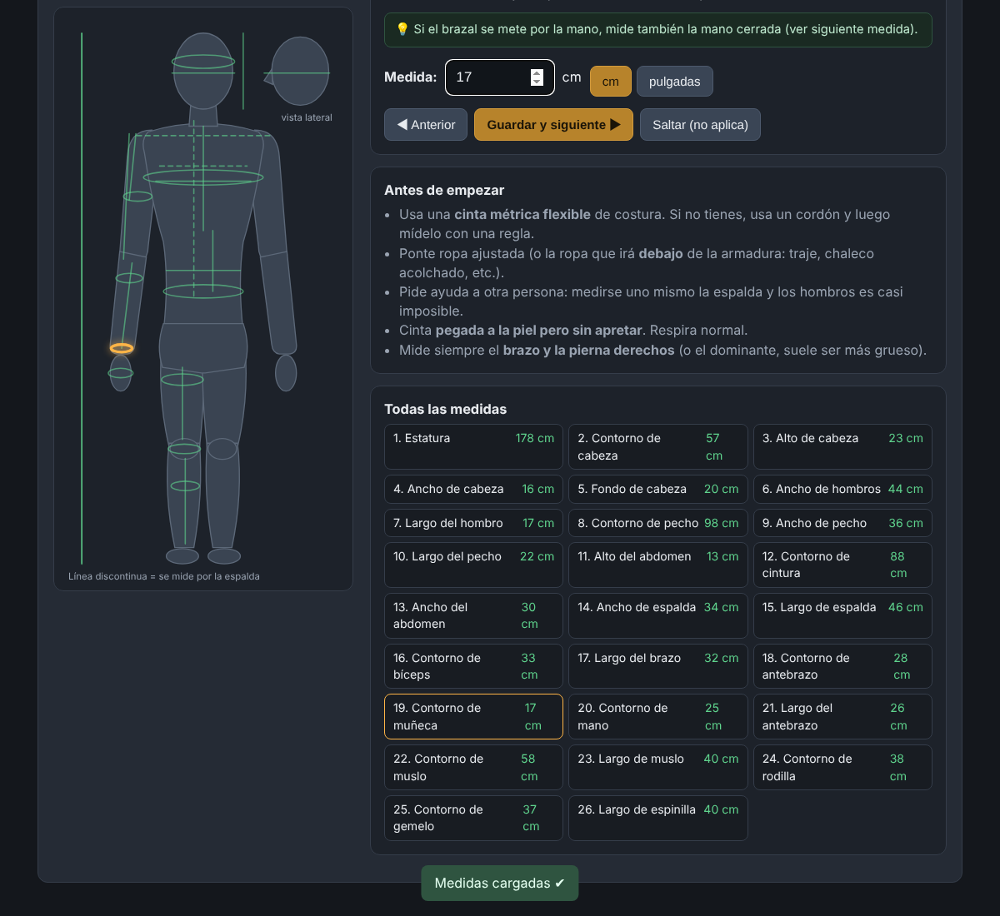

# Maniquí de medidas · Armadura Din

Página web (un solo archivo, `index.html`, sin instalar nada) para medir a una persona **a distancia** y escalar las piezas de una armadura impresa en 3D.

## Uso
1. **Medir**: la persona abre `index.html` en el móvil o el ordenador. Un maniquí le marca en naranja dónde va la cinta y le explica paso a paso cómo tomar cada una de las 26 medidas (cabeza, hombros, pecho, abdomen, espalda, bíceps, antebrazo, muñeca, mano, muslo, rodilla, gemelo y espinilla).
2. **Enviar**: copia el texto o lo manda por WhatsApp. Incluye un código `ARM1:...`.
3. **Escalar**: quien imprime pega el código, mide cada pieza en su slicer (en mm, al 100 %) y obtiene el % de escala por pieza (uniforme y no uniforme X/Y/Z), con holguras editables para el acolchado.

Las medidas se guardan solas en el navegador (localStorage).
